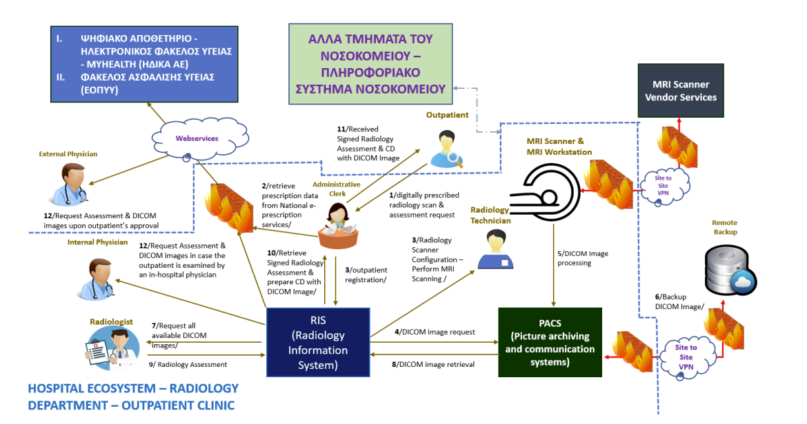

# NIS2 security policies for a hospital radiology department

A set of security policies and matching technical measures that bring the operational workflow of a hospital
**radiology department** into compliance with the EU **NIS2** directive. Produced for the **Google.org Cyber
Route** program (2025), Aristotle University of Thessaloniki.

The scenario is a generic (hypothetical) radiology department — no real organization, people or data are
involved. The work maps a realistic clinical workflow to concrete, role-based security controls.

## The environment

The policies cover the department's full ecosystem: the systems that store or process data (RIS, PACS, the
MRI scanner/workstation, the Hospital Information System, and the national MyHealth/ΗΔΙΚΑ services), the
external connections (site-to-site VPNs to remote backup and to the MRI vendor, plus web-service links to
national e-prescription), and the people involved (outpatient, administrative clerk, radiology technician,
radiologist, internal and external physicians).

## The policies

Each policy follows the same structure — purpose, scope, principles, procedures and the specific technical
measures that enforce it — and is tied to the relevant NIS2 risk-management requirements.

1. **Access Control & Roles** — least-privilege access per role, with attribute-based access for internal
   physicians (tied to admission status) and consent-based access for external physicians via MyHealth; MFA on
   every externally reachable system; dual-approval account provisioning and immediate de-provisioning on
   departure.
2. **Update / Patch Management** — how operating systems, medical-device software and applications are kept
   current, including the special handling that vendor-managed medical equipment requires.
3. **Data-at-Rest Security** — encryption and protection of stored DICOM images, patient records and backups.
4. **Data-in-Transit Security** — securing the VPN and web-service links between systems and external parties.
5. **Network Segmentation & Secure Connectivity** — isolating the radiology systems, the MRI/vendor path and
   the hospital network from one another.
6. **System & Services Acquisition** — security requirements built into procurement of new systems and vendor
   services.

## What this demonstrates

- Reading a real-world operational workflow and deriving a least-privilege access model from it
- Translating a regulatory framework (NIS2) into concrete, enforceable technical controls
- Security governance for a healthcare / critical-infrastructure setting, where availability and patient
  privacy both matter

## Files

- [`docs/security-policies-gr.pdf`](docs/security-policies-gr.pdf) — the full policy document (Greek)
- [`architecture.png`](architecture.png) — the radiology department data-flow diagram

> The policy structure draws on the CIS / MS-ISAC NIST Cybersecurity Framework Policy Template Guide (2024),
> which is published separately by CIS and is not redistributed here.

Author: Stergios Loukas
